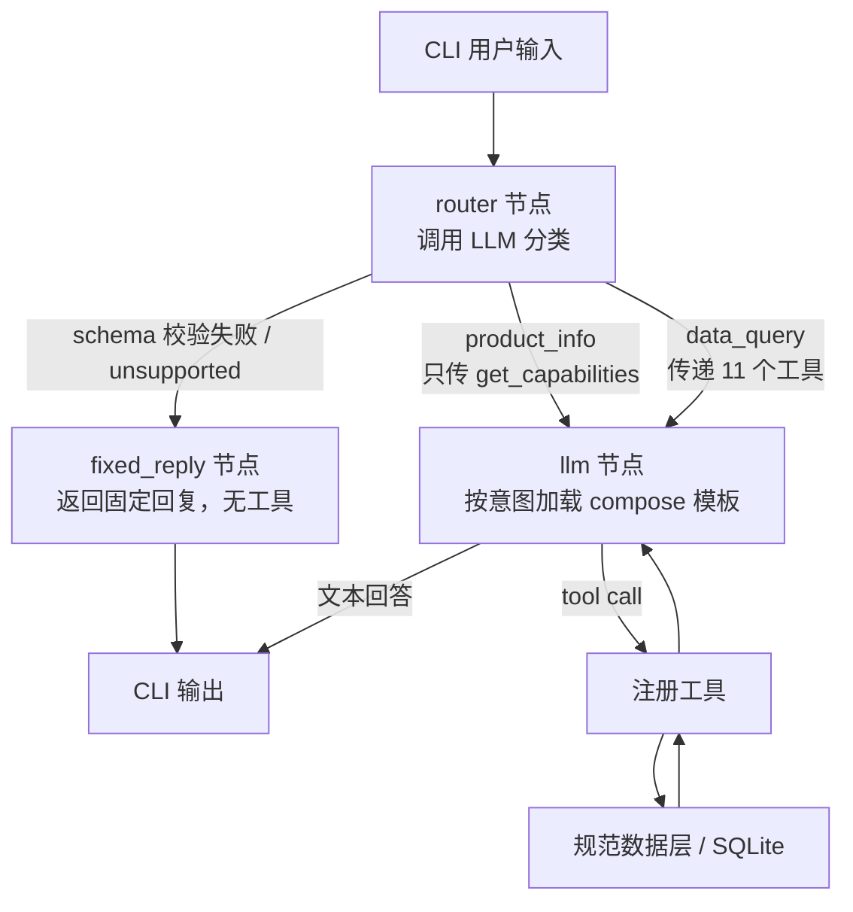
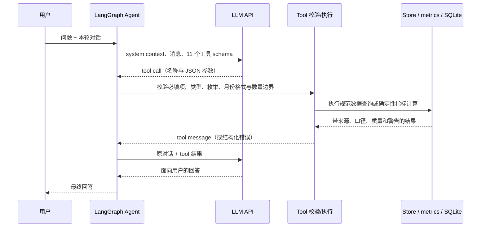

# AI Advisor

IBKR PortfolioAnalyst 自开户报告导入、dashboard 和 LangGraph CLI 助手。

## 快速开始

```powershell
python dashboard.py --ingest data/report_since_inception.plain
python -m advisor
```

在项目根目录复制 `.env.example` 为 `.env` 并配置 `LLM_API_KEY`、`LLM_BASE_URL`、`LLM_MODEL`。`APP_TIMEZONE` 默认为 `Asia/Singapore`。每轮模型请求动态传递本地日期/时间及时区，并单独传递报告数据截止日。CLI 输入 `/import-report` 可交互提供路径；直接回车采用 `data/report_since_inception.plain`。成功或重复导入后会刷新根目录 `dashboard.html`。

CLI 命令：`/help`、`/import-report [路径]`、`/history`、`/clear`、`/remember key=value`、`/recall`、`/exit`。短期对话 checkpoint 和长期记忆均为内存实现，进程结束后清空。

## 数据模型、适配与持久化

每次输入报告先由来源 adapter 解析。PA section 名及表头只由 `pa_analytics.loader` 识别；`adapt_portfolio()` 等函数把来源字段映射为规范化观测。业务工具通过规范模型与数据层访问，不直接依赖 PA section 或源表头。

SQLite 数据库默认为 `data/pa.db`，采用多表数仓（Warehouse）分层架构：

- `snapshots`：每次完整报告快照的元数据与解析后的 payload JSON，按源文件 SHA-256 去重。完全相同的文件再次导入返回 duplicate；不同内容的报告另存快照，保留旧版。当前报告按报告截止日期选择最新快照。
- `table_account_metadata`：规范化账户级元数据（基准币种、起止日期、基准清单、校验结果与关键统计）。
- `table_portfolio`：规范化月末资产记录，字段包括 `snapshot_id`、`account_id`、`term_month`、`value`、`currency` 以及各类资产月末市值（`etfs`、`stocks`、`options`、`futures_options`、`cash` 等）。月份范围查询从该规范表检索。
- `table_monthly_returns`：规范化月度收益率与基准收益，字段包括 `term_month`、`account_return`、`bm1_return`、`bm2_return`、`bm3_return`。
- `table_monthly_contributions`：规范化月度各品种收益贡献百分点（`etfs`、`stocks`、`options`、`futures`、`futures_options`、`fs_options`、`cash`）。
- `table_flows`：出入金资金流记录，字段包括 `flow_date`、`flow_type`、`description`、`amount`。
- `table_cash_transactions`：现金交易明细表，统一记录利息（interest）、其他费用（fee）和股息（dividend）的逐笔日期与发生额。
- `table_symbol_pnl`：合约级累计盈亏明细，字段包括 `symbol`、`instrument`、`avg_weight`、`ret_pct`、`contribution`、`unrealized`、`realized`、`total_pnl`、`open_status`，支持毫秒级排名前 N 赢家与输家查询。
- `table_open_positions`：最新报告持仓记录，字段包括 `as_of_date`、`instrument`、`currency`、`symbol`、`quantity`、`close_price`、`value`、`cost_basis`、`unrealized`。
- `table_risk_measures`：规范化月度风险指标表（最大回撤、夏普、索提诺、波动率等指标及其基准对比）。
- `table_yearly_returns`：规范化自然年收益表，记录账户年度收益率及基准同期收益率。
- `table_official_returns`：报告官方滚动区间收益表（MTD、QTD、YTD、1Y、3Y、5Y、Since Inception）。
- `table_asset_weights`：资产类别配置与集中度权重表（市值口径）。
- `data/raw/`：原始报告归档，文件名带账户、报告截止日和哈希前缀。

Store 初始化时会自动执行 `_ensure_columns()` 和 `_backfill()`，确保现有已导入快照无缝升级并填入所有分表。Store 向上提供纯净的结构化 Data API（如 `get_portfolio_series()`、`get_portfolio_breakdown()`、`get_monthly_returns_data()`、`get_monthly_contributions()`、`get_flows_data()`、`get_cash_transactions()`、`get_risk_measures_data()`、`get_yearly_returns_data()`、`get_official_returns_data()`、`get_open_positions_summary()`、`get_top_contributors()` 等）。

所有 11 个工具统一通过 `pa_analytics.registry` 声明并经 `advisor.tools.create_tools(store)` 注册。LLM 不能执行任意 SQL；tool 函数统一经 Store 规范数据层和指标计算层查询规范数据，彻底解耦对底层报告原始反序列化对象的直接访问。参数使用明确的区间与标准窗口标签，消除特例硬编码。

## Dashboard

dashboard 使用同一套 PA 指标计算，提供 YTD、1M、3M、6M、1Y、3Y、5Y、自开户区间；展示资产曲线、账户对 SPXTR/EFA/VT 的累计收益曲线、配置变化和收益归因。数据月度精度、部分月份和归因估算警告见看板的数据说明。

## Agent、Graph、记忆与 LLM



Graph 由 `router`、`llm`、`tools` 与 `fixed_reply` 节点组成：
1. **router 节点**：接收用户输入后首先调用 LLM 进行意图识别，将问题分发至 `data_query`、`product_info` 或 `unsupported`。输出经过严格 JSON schema 校验，分类纯基于 LLM 语义判断（无关键词匹配）。若输出异常或 schema 校验失败，安全回退至 `unsupported`。
2. **意图 Profile 注册表与 compose 模板**：
   - 每个意图在 `INTENT_PROFILES` 注册表定义了版本号、对应的 compose 模板（位于 `prompts/<intent>.compose.md`）、允许调用的工具列表 (`allowed_tools`) 与策略检查项 (`policy_checks`)。
   - `data_query`（v1.0）：加载 `data_query.compose.md`，允许全量 11 个数据分析工具。已全量迁入单月归因五段式及约束规则，且示例数值均已转换为占位符。
   - `product_info`（v1.0）：加载 `product_info.compose.md`，仅允许 `get_capabilities`，回答系统边界与数据来源等元问题。
   - `unsupported`（v1.0）：直接路由至 `fixed_reply` 节点输出固定友好答复，不调用 LLM 与任何工具。
3. **llm 节点与 tools 节点**：依据意图加载专属 compose 模板与时区、数据截止日上下文，仅向模型提供对应意图声明的工具 schema；如返回 tool call，执行工具后作为 tool message 回传，直至产出最终答复。

LangGraph `MemorySaver` 按 thread 保存短期消息；`InMemoryStore` 按 user namespace 保存 `/remember` 明确写入的键值，并在后续模型请求中提供。两者当前均为进程内存，不跨 CLI 重启持久化。

LLM 通过 `httpx` 调用 OpenAI-compatible `/chat/completions`。配置从环境变量或项目根 `.env` 读取。每个运行实例在 `logs/advisor_<datetime>_<random_ID>.jsonl` 记录用户输入、router 分类事件、HTTP 请求/响应、tool 调用/结果、记忆操作和最终回答；Authorization header 不写入日志。

## 单月归因策略注入与约束引用（案例分析）

以“9 月份收益率如何，做得好不好”为例，说明单月归因策略如何被注入、以及回答中“K13”这类约束引用从何而来。

### 策略注入：按意图加载 Compose 模板

原有 `why_month_policy.md` 的无条件全量注入已被移除，其内容完整迁入 `prompts/data_query.compose.md`。

1. **按需加载**：当用户提问被 `router` 归类为 `data_query` 时，`_llm` 才会读取并注入 `data_query.compose.md`，避免在元信息问答或非数据场景中浪费 context 窗口。
2. **模板占位符化**：原策略文件中写死的具体数字（如“110 个完整月”、2025-03 样例的具体数值与区间金额）均已重构为通用模板占位符（如 `{{total_complete_months}}`、`{{example_month}}`、`{{example_twr}}` 等），确保提示词规范且数据中立。

### 约束引用：K13 的字面量来自工具，定义来自约束源

回答里出现的“K13”并非 prompt 编造，而是工具 `get_month_detail` 计算后写进返回值、模型照抄：

```
pa_analytics/constraints.py  K13 定义（唯一事实源；get_capabilities 与看板“数据说明”均由此生成）
        │
        ├─ get_capabilities → 告知模型“现金类归因受 K13 约束”
        │
pa_analytics/metrics.py      get_month_detail 把“见 K13”写进 cash_category.note 与 boundary.cannot_say
        │
advisor/agent.py             通过 data_query.compose.md 注入对应规约
        │
prompts/data_query.compose.md 两条规则强制引用：
   · 第 3 段“收益构成”：现金类必须单独列出“未解释部分”的金额与说明（标注 K13）
   · 第 4 段“边界声明”：逐条引用工具返回的 boundary.cannot_say
        │
        ▼
   LLM 照抄工具返回的 K13 文字 → 最终回答
```

即：compose 模板负责规范必须引用的格式和负面清单，K13 的**内容**由 `get_month_detail` 产出、**定义**由 `constraints.py` 提供。这符合“报告专属内容只在 source adapter / 约束源，工具用规范模型”的约定。

## Agent 工具清单、调用链与标准示例

以下 11 个工具当前已注册到 Agent。窗口参数使用 `YTD`、`1M`、`3M`、`6M`、`1Y`、`3Y`、`5Y`、`ALL`；明细工具使用含首尾的 `YYYY-MM` 月份范围或单月份。`get_top_contributors.n` 允许 1–20。

| Tool | 说明 | 参数 | 示例问题 |
|---|---|---|---|
| `get_capabilities` | 报告覆盖范围、可回答/不可回答主题、数据约束、导入校验和快照列表 | 无 | “这份报告能回答哪些问题？有什么限制？” |
| `get_portfolio_detail` | 从规范化 `table_portfolio` 查询月份范围内的月末资产值 | `start_month`, `end_month` | “列出 2026 年 9 月到 10 月的月末资产。” |
| `get_month_detail` | 用于回答某月收益高或低的原因，只给类别层面的收益占比，不能指明具体交易。包含当月精确盈亏、剔除入金、贡献自洽门禁与现金未解释项 | `month` (`YYYY-MM`) | “为什么 2025 年 3 月收益这么高？” |
| `get_window_summary` | 期初/期末资产、资金流、区间盈亏、月度链接 TWR 和三项基准收益 | `window`，默认 `YTD` | “过去一年资产变化多少？比三个基准如何？” |
| `get_monthly_returns` | 返回窗口内各月账户收益率、最高/最低收益月份和同期基准月收益 | `window`，默认 `YTD` | “过去三年哪个月份收益率最高？” |
| `get_attribution` | 某窗口按资产类别的盈亏归因及每项质量标记、口径警告。不得用窗口归因推断某个月的原因 | `window`，默认 `YTD` | “今年收益主要来自哪些类别？” |
| `get_yearly_table` | 每个自然年的期初/期末资产、资金流、盈亏、TWR 和归因 | 无 | “哪一年收益最好、哪一年最差？” |
| `get_cash_interest` | 区间利息、其他费用、平均月末现金、近似隐含年化利率 | `window`，默认 `YTD` | “今年利息、费用和现金隐含年化收益率是多少？” |
| `get_top_contributors` | 按合约列出累计已实现加未实现盈亏赢家/输家及品种汇总；不能按时间切片 | `n`，默认 10，范围 1–20 | “自开户以来盈亏最高和最低的合约是什么？” |
| `get_risk_measures` | 报告提供的月度风险指标与基准对比 | 无 | “最大回撤、夏普和恢复期是多少？” |
| `get_open_positions` | 当前持仓、资产类别市值权重和当前按币种现金 | 无 | “现在的持仓配置和 SGD/USD 现金分别是多少？” |

### 通用调用链



模型不得自行查询 SQL 或代替工具做精确算术。对报告不支持的问题，Agent 应调用 `get_capabilities`，说明缺少的数据并拒绝给出无法验证的结论。工具参数错误返回包含 `status=error` 和错误码的结果，不应使 Graph 崩溃。

### 示例问题与标准答案

以下数值是当前快照（账户 `U9628699`，PA 报告截止 2026-10-09）的回归参考值；重新导入新快照后，标准数值会随数据变化。金额为 SGD，数字四舍五入展示。

1. **“过去三年哪个月份收益率最高？”**

   调用链：`用户问题 → get_monthly_returns(window="3Y") → monthly_return_extremes / 报告月度收益率与基准数据 → LLM 回答`。该窗口由统一的窗口解析器确定，工具返回完整月度序列及排序结果；最后一个报告月可能是部分月。

   标准答案：2023-11 至 2026-10 的 36 个报告月份中，最高为 2025-03，账户月度 TWR +4.49%。同期 SPXTR −5.63%、EFA +0.18%、VT −3.52%。窗口也包含 2026-10，但该月截至 2026-10-09，属于部分月；最低月份为 2025-05，账户月度 TWR −4.02%。

2. **“列出 2026 年 9 月到 10 月的月末资产。”**

   调用链：`用户问题 → get_portfolio_detail(start_month="2026-09", end_month="2026-10") → Store 查询 table_portfolio → LLM 整理序列`。

   标准答案：2026-09 月末资产为 707,216.54；2026-10 报告截至 10 月 9 日，资产为 713,223.18，该点是部分月，不是完整月末。

3. **“过去一年资产变化多少？和三个基准比如何？”**

   调用链：`用户问题 → get_window_summary(window="1Y") → window_summary / 月度收益链接与资金流计算 → LLM 回答`。区间内 12 个收益月份为 2025-11 至 2026-10；资产 opening 取区间前的 2025-10-31。

   标准答案：期初 532,216.57（2025-10-31），期末 713,223.18（2026-10-09），资产变化 +181,006.61；净转入 +77,000.42，区间投资盈亏 +104,006.19，月度链接 TWR 为 19.35%。基准同期收益：SPXTR 15.50%、EFA 13.17%、VT 15.57%；账户分别领先约 3.86、6.18、3.78 个百分点。PA 官方按日滚动 1 年参考值为 21.08%，起点口径不同，需单独标注。

4. **“今年收益如何，比标普好吗？”**

   调用链：`用户问题 → get_window_summary(window="YTD") → 同期账户/基准月度收益链接 → LLM 回答`。

   标准答案：截至报告日，2026 YTD 月度链接 TWR 为 16.73%；SPXTR 为 15.14%，账户领先约 1.58 个百分点。报告只到 2026-10-09，10 月是部分月。

5. **“今年的收益主要来自哪些资产类别？”**

   调用链：`用户问题 → get_attribution(window="YTD") → window_attribution → LLM 总结各桶并附质量/警告`。

   标准答案：YTD 净值口径盈亏为 +92,088.92。归因估算：股票/ETF +4,669.06、股票期权 +3,898.15；期货/期货期权/外汇合并剩余项 +77,660.39；精确利息 +5,930.28，其他费用 −68.96。股票/ETF 与股票期权是估算；期货、期货期权和外汇不能可靠拆分（K2–K5）。股息 97.80 仅作备注，归属未验证。

6. **“哪一年收益最好、哪一年最差？”**

   调用链：`用户问题 → get_yearly_table → yearly_table → LLM 按自然年 TWR 排序`。

   标准答案：按自然年 TWR，最好为 2023 年 +31.88%；最差为 2018 年 −28.16%。按 SGD 盈亏金额，2020 年最低，为 −406,559.14。回答“最好/最差”时要说明按收益率还是金额排序。

7. **“今年现金利息和隐含收益率是多少？”**

   调用链：`用户问题 → get_cash_interest(window="YTD") → 现金利息与月末现金均值计算 → LLM 回答并注明近似口径`。

   标准答案：截至 2026-10-09，YTD 利息 +5,930.28，其他费用 −68.96，平均月末现金约 592,820.54 SGD，隐含年化收益率约 1.29%。现金均值是按月末、跨 SGD/USD 换算后的近似值，利息也可能包含借款利息。

8. **“历史上盈亏最大的合约是什么？”**

   调用链：`用户问题 → get_top_contributors(n=3) → top_contributors → LLM 引用赢家/输家并说明口径`。

   标准答案：合约级累计盈亏赢家首位 ESM5，+107,932.36 SGD；输家首位 SPY，−53,431.09 SGD。口径是累计已实现加未实现盈亏，不可按时间切片；总和与 MTM 不同，标的/合约没有进一步合并（K10）。

9. **“最大回撤是多少，恢复情况如何？”**

   调用链：`用户问题 → get_risk_measures → PA 月度风险指标 → LLM 引用原始指标并附月度限制`。

   标准答案：PA 风险区块给出的最大回撤为 65.20%，峰值至谷底为 2018-01 至 2020-03，恢复期字段为 75 个月。数据只有月度精度，会低估月内回撤；不能把该指标解释为日内最大回撤。

10. **“目前 SGD 和 USD 现金分别是多少？资产配置如何？”**

   调用链：`用户问题 → get_open_positions → open_positions → LLM 区分币种现金与多空权重分母`。

   标准答案：2026-10-09 持仓报告列出 SGD 现金 193,979.95；USD 现金 365,251.95，按报告汇率 1.2807 折合 467,778.17 SGD。资产类别多头权重中 Cash 约 92.40%、Equities 约 7.59%。空头侧 Equities 约 97.58% 是以总空头市值为分母，不能说成账户净值的 97.58%。这些是市值口径，不代表风险敞口（K9）；报告也没有证券/期货分段现金或历史币种现金。

11. **“这份报告能否告诉我账户杠杆是多少？”**

    调用链：`用户问题 → get_capabilities → NOT_ANSWERABLE / K7 → LLM 说明限制并拒答数值`。

    标准答案：不能。PA 报告没有占用保证金和剩余流动性数据，无法计算杠杆；需要导入含保证金字段的数据后才能评估。不能根据现金占比推断杠杆或风险低。

12. **“我 9 月份收益率如何，做得好不好？”**

    调用链：`用户问题 → get_month_detail(month="2026-09") → month_detail / 单月 TWR、资金流、品种贡献与边界 → LLM 按 why_month_policy 五段式回答`。这是单月归因问题，`why_month_policy.md` 强制模型走五段式并逐条引用 `boundary.cannot_say`。

    标准答案：2026-09 账户月度 TWR +1.59%，SPXTR −0.35%，在 110 个完整月中排第 59（中等偏上）。月初净值 649,393.13、月末 707,216.54，净值变化 +57,823.41；当月净流入 +47,000.42（存入 50,000.42、取出 3,000.00），扣除流入后投资盈亏 +10,822.99。品种贡献（consistency=ok，仅供占比参考）：ETF +0.2950pp、股票期权 +0.1687pp、期货/期货期权合并 +0.6526pp、现金类 +0.4666pp（其中利息 +850.45、费用 −5.61、未解释部分约 2,345.26，标注 K13）。边界声明逐条引用 `cannot_say`：不能定位具体交易/合约/方向/时间（K8）、不能拆分期货与期货期权（K3）、不能断言现金未解释部分来源（K13）、无法给出杠杆/保证金/名义敞口（K7、K9）。

## Smoke check

```powershell
python -c "from pa_analytics import Store; from advisor.tools import create_tools; s=Store('data/pa.db'); print(f'已注册工具 ({len(create_tools(s))} 个): {[t.name for t in create_tools(s)]}')"
python -c "from pa_analytics import Store; from advisor.tools import portfolio_detail_tool; s=Store('data/pa.db'); print(portfolio_detail_tool(s).fn(start_month='2026-01', end_month='2026-10'))"
python dashboard.py
```

前两条检查已导入数据能经规范数据层与注册工具返回记录（兼容原有 `portfolio_detail_tool` 接口）；第三条检查 dashboard 可由当前快照正常生成。不包含 LLM 网络调用。
